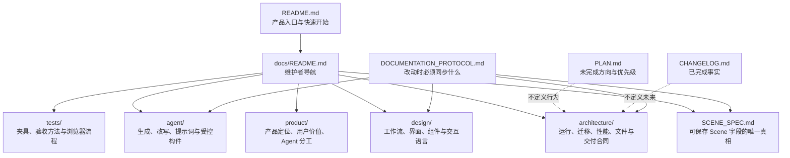
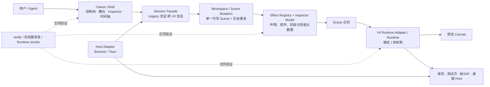

# ToSampool 文档架构与提交边界

> 本文回答两个问题：**遇到一个问题该先读哪份文档**，以及**哪些文件必须在同一类提交中变化**。
> 产品当前对外名称为 **ToSampool / 图森破**；旧文档中的 Patcharium / 拼好景是历史名称，除非某份文档明确讨论 Legacy，否则应将其理解为同一产品的旧称。

## 1. 文档的职责层级



| 入口 | 负责回答 | 不负责回答 |
|---|---|---|
| `README.md` | 产品是什么、如何开始使用 | 每个字段与渲染细节 |
| `docs/README.md` | 某类问题该进入哪份专题文档 | 重复专题内容 |
| `SCENE_SPEC.md` | 可保存数据、Runtime 语义与兼容边界 | 编辑器临时选择状态与 DOM |
| `docs/architecture/` | 模块边界、迁移规则、性能与交付合同 | 产品叙事与视觉风格 |
| `docs/design/` | 用户工作流、信息层级、组件和交互 | Runtime 像素算法 |
| `docs/agent/` | Agent 可以怎样规划、生成、改写、验证 | 将任意 Agent 输出直接当作可信运行代码 |
| `tests/` 与 `docs/architecture/ACCEPTANCE_TEST_MATRIX.md` | 如何证明一项能力没有回归 | 代替人工视觉验收 |
| `PLAN.md` / `CHANGELOG.md` | 待做事项 / 已完成事实 | 作为格式或行为的唯一规范 |

## 2. 当前代码架构：从用户动作到像素与交付



### 两个会话不可混写

```text
Classic Shell
├─ LegacyFacade → HOME_SCENE / 任意 program.code → Legacy Runtime → JS
└─ V4Facade     → 声明式 v4 Scene              → V4 Runtime     → .tosampool.json
```

Legacy 是冻结体验基线；v4 是新数据合同与处理管线。两者可以共用外壳和用户动作，但不能在一次编辑中双写，也不能把任意旧 `program.code` 偷渡进 v4 JSON。完整理由与迁移顺序见 [v4 Classic Shell 迁移总规范](architecture/V4_MIGRATION_MASTER_SPEC.md)。

## 3. 文档阅读路径

| 你要做的事 | 先读 | 再读 |
|---|---|---|
| 新增对象或场景效果 | `architecture/EFFECT_SYSTEM_VNEXT.md` | `V4_EFFECT_FOUR_LAYER_CHECKLIST.md`、`V4_EFFECT_LANDING_POINTS.md`、[`../tests/V4_EFFECT_TESTING.md`](../tests/V4_EFFECT_TESTING.md) |
| 改 Inspector 控件或卡片 | `architecture/INSPECTOR_CONTROL_SYSTEM.md` | `design/INSPECTOR_EFFECTS_VNEXT.md`、`design/COMPONENT_REGISTRY.md` |
| 改 Canvas、树、时间轴手势 | `architecture/EDITOR_BEHAVIOR_SPEC.md` | `architecture/V4_MIGRATION_MASTER_SPEC.md`、相应浏览器夹具 |
| 改 Scene 字段、保存或转换 | `SCENE_SPEC.md` | `architecture/VNEXT_SCENE_CONTRACT.md`、`architecture/LEGACY_V4_CONVERSION.md` |
| 改 Runtime、缓存或大图性能 | `architecture/RUNTIME_CONTRACT.md` | `architecture/V4_PREVIEW_PERFORMANCE_CONTRACT.md` |
| 接入浏览器文件或 Tauri 文件能力 | `architecture/HOST_ADAPTER.md` | `architecture/ASSET_RESOLVER.md`、`architecture/TAURI_HOST.md` |
| 让 Agent 生成或修改场景 | `agent/AGENT_TOOL_PROTOCOL.md` | `agent/AGENT_GENERATE_SPEC.md`、`agent/EFFECT_MANIFEST_VNEXT.json` |

## 4. 本次基线的提交结构

本轮不是一个普通功能补丁，而是把 v4 迁移从散落的实验文件收束为可验证基线。因此采用 **四个有依赖、可独立回滚的提交**，按下列顺序提交：

1. **`docs(v4): establish architecture, migration and verification contracts`**
   包含规范、迁移矩阵、效果四层台账、设计信息架构、Agent manifest 与测试说明。它只声明“什么算正确”，不改变用户画面。
2. **`feat(v4-core): add declarative scene, runtime and test contracts`**
   包含 `vnext-*` 状态/模型、Runtime、Scene 序列化、素材和图元/粒子基础设施、构建脚本及核心单元测试。它建立“数据如何跑”。
3. **`feat(v4-classic): bridge the legacy shell to the v4 editing session`**
   包含 `img2asset-v4-classic.html`、Classic Controller、共享颜色/图样/效果卡控件、Facade、浏览器 parity 流程及对象效果 Inspector。它建立“用户如何编辑”。
4. **`fix(legacy-desktop): preserve current delivery and desktop-host baseline`**
   包含仍在使用的 Legacy Runtime/编辑器修复、测试场景与素材内嵌、Tauri Host、性能读数与配套验证。它保护当前可用产品，不让 v4 迁移破坏既有闭环。

每一提交都必须同时带上对应测试；不得把 `node_modules/`、`src-tauri/target/`、`.tauri-dist/`、`.local/`、受限制的案例资产或临时诊断物纳入版本控制。

## 5. 提交前的判定

```text
新增效果？      → Registry + Inspector + Runtime + 测试，四处必须同时出现。
改变 Legacy？    → 先补基线/复现，再同步 Classic Shell；不能借迁移顺手改体验。
改变 v4 数据？   → Scene 合同 + 序列化/转换 + Runtime + 保存重开测试。
改变桌面文件？   → Host Adapter + Tauri 测试；Runtime 不直接引用 Tauri。
只有新想法？    → PLAN；未实现内容不能写进 CHANGELOG。
```

这份图只定义文档和提交的组织方式。具体功能是否已完成，仍以迁移矩阵、测试结果和人工验收为准。
