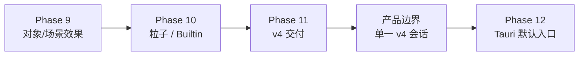

# V4 能力收尾台账

> 2026-10-14：场景级ASCII映射首版已接入Registry、Inspector、独立效果轨和统一导出，并加入verify-v4。可选GPU字形合成／CPU回退；1080p边缘强化目前不满足30fps预算，不能标为全质量实时完成。见 [实现合同与性能](V4_ASCII_MAPPING_2026-10-14.md)。

> 目的：管理 **v4 自身能力是否完整可交付**，以及产品入口是否真的只持有 v4 Scene。
> Legacy 页面与 Legacy → v4 转换器是独立工具；它们不再属于 v4 编辑器会话。

## 总体关系

这里的关键顺序是：**先保证 v4 Scene 自己能编辑、播放、保存与交付；随后让产品入口只接受 v4 JSON。** Legacy 继续作为冻结页面与外部转换工具，不回流进产品入口。

## B0：v4 产品边界

| 内容 | 当前事实 | 验收 |
|---|---|---|
| 单一会话 | `img2asset-v4-classic.html` 只创建 `v4` Workspace；不再初始化 `HOME_SCENE` | `tests/browser/v4-product-boundary.mjs` |
| Runtime 边界 | 页面不加载 `home-scene.js`、`runtime-inline.js` 或 `legacy-v4-converter.js` | 同上，且启动无页面错误 |
| 文件边界 | 新建、打开、保存只处理 `.tosampool.json`；Legacy JS 返回明确阻止错误 | `tests/scene-file-controller.mjs` |
| 真实编辑流 | 工具栏创建图元，写入 v4 Scene，并由 v4 Canvas 重新命中选择 | `tests/browser/v4-product-flow.mjs` |
| 剩余源码收束 | Classic Shell 内仍有尚未删除的 Legacy 工具函数，但 v4 路径不执行它们 | 逐模块提取/删除前先补 v4 浏览器夹具；不得为清理而降低体验 |

## 当前基础编辑契约

这些不是新的视觉效果，而是 v4 之后所有工具都必须遵守的编辑底线：

| 能力 | 固定语义 | 实现 / 验收 |
|---|---|---|
| 像素几何 | 持久 `X / Y / W / H` 为整数；Linear 可在数据中插值，但最终绘制帧再次吸附整数像素。旋转、缩放、透明度保持小数。 | `10-scene-normalize.js`、`30-frame-state.js`、Runtime smoke |
| 画板投影 | v4 画板只按当前 Scene 的宽高等比 `contain` 并居中；不复制 Legacy 的 CSS 尺寸。舞台外侧为深色工作空间，新建 Scene 默认白底。 | `classic-v4-view-controller.js`、浏览器像素画布夹具 |
| 框选 | 左→右为“完全包含”，右→左为“相交即选”；只在普通对象层级生效，不绕开组/图元下钻语义。 | `classic-v4-view-controller.js`、`verify:pixel-canvas` |
| 像素铅笔 | 工具栏钢笔位创建声明式 `stroke` 图元；原始整数路径保留，支持0–100非破坏平滑；共用端点／转角／虚线，预览与最终描线一致。完成度0–100支持所属对象轨Linear，反向绘制为Step，各笔触数值独立、共用切段。独立绘制为单笔触 vector，选中已有对象时作为附着图元。沿路径的宽度变化后置。 | Drawing / 共用描线控件 / Parts / Runtime / Canvas hit / 路径描线与笔触完成度浏览器夹具 |
| 斜切变换 | `skewX / skewY`（界面名“水平斜切 / 垂直斜切”）是通用仿射变换：适用于图片、文字、图元、组与导出；它不是四点透视。选择边框跟随实际仿射矩阵，但控制点置于独立屏幕层，始终保持固定像素尺寸；四角等比/自由缩放，四边中点单轴缩放，`Alt` 拖上下/左右中点分别调整水平/垂直斜切。真实透视需缓存/网格渲染，后置为可选高成本能力。 | Frame matrix / Content renderer / Inspector / Runtime smoke / Pixel canvas browser fixture |
| 素材预处理 | 入库前只固定尺寸、取样色去背景、容差、边缘柔化和边缘连通性；色板、量化、再像素化属于对象/场景采样，不写入素材。 | `vnext-asset-recipe.js`、素材预处理弹窗 |

## 收尾定义

一个条目只有同时满足下列条件才标记 `complete`：

1. Registry / Scene schema / Runtime / Inspector 的字段一致；
2. 固定时间 Runtime、保存重开与真实浏览器流程通过；
3. 可观察画面、参数语义和性能预算已人工验收；
4. 对应文档不再与迁移矩阵相互矛盾；
5. 若涉及交付，测试页与导出结果不依赖编辑器私有状态。

`browser-parity` 表示浏览器流程已覆盖，不等于能力、性能或产品体验已经最终收口。

## W9：效果系统收尾

| 编号 | 内容 | 当前事实 | 完成标准 |
|---|---|---|---|
| W9.1 | 效果 Registry 四层一致性 | 新增机器四层合同已核对 13 个效果 / 1 个控制器；Runtime smoke 与浏览器组合流已通过 | 每个已发布效果都有四层落点、保存重开与真实画面夹具 |
| W9.2 | 效果视觉与参数语义 | 成样 / 蒙版 / 加样 / 采样已接入；部分效果仍在调校 | 收缩/统一参数名，确认默认画面与性能，不再保留无效或重复效果 |
| W9.3 | 对象与场景效果时序 | Step/Linear 与独立轨已接入 | 全部效果卡重开恢复、快捷时序入口和阶段调序经过人工验收 |
| W9.4 | Inspector 信息层级 | 共享颜色、图样、效果卡模块已抽出 | 不再出现“启用后需重新切页才显示”、同义参数分裂或卡片空态误导 |
| W9.5 | S/M/L 性能夹具 | Auto / Draft 和主要压力夹具已存在 | 每个 C 级像素效果有工作像素与降级证据；重像素 Full 路径明确为离线成本 |

**当前先做：W9.1 → W9.4。** 先让每个效果真实出现、可调、可重开，再讨论新增视觉预设。

## W10：粒子、Builtin 与转换收尾

| 编号 | 内容 | 当前事实 | 完成标准 |
|---|---|---|---|
| W10.1 | 粒子时间语义 | 四类预设、动态来源引用、Step 轨与图片源的“按粒子年龄播放”均已接通；矢量 / 文字 / builtin 仍共用单视觉胶囊 | 固定时间多帧视觉夹具、继承边界与缓存预算经人工验收 |
| W10.2 | Builtin 覆盖 | 已有 pixel-star、pixel-cloud、train-beam 三个纵切片 | 每个 builtin 有 manifest、参数白名单、边界、固定时间视觉夹具；不承诺穷举旧专用函数 |
| W10.3 | 外部 Legacy 转换 | 声明式图片/parts/基础时序可转；未知程序分流到项目 Module、冻结、人工或真正阻塞 | 报告 v2、完整 Module 保真实验与逐项确认；v4 编辑器不读取 Legacy JS |

## W11：v4 交付收尾

| 编号 | 内容 | 当前事实 | 完成标准 |
|---|---|---|
| W11.1 | 自包含测试页 | Runtime、asset locator 与冻结素材测试页已由真实 Edge 验收 | v4 Scene 在 browser/Tauri 各自 Host 下独立打开、素材策略明确 |
| W11.2 | 帧与 GIF | v4 专用固定时间导出器已通过真实 Edge：当前帧 PNG、Sprite PNG、多帧 PNG、GIF | 导出面板的人机验收、透明 / 大图预算及正式桌面交付验收 |
| W11.3 | 交付边界 | Scene / Runtime / Host 已分层；v4 帧导出不改写持久 Scene，自包含测试页只携带 Runtime 与冻结素材 | 透明 / 大图、实际下载与桌面 Host 的人工交付验收 |

## 仍不属于本台账的工作

- 历史 JS 的无损全自动转换；
- v4 默认 Tauri 入口切换；
- Project / assets 持久化与个人素材库。

这些工作依赖 W9–W11 与 B0，但不能为了转换或清理而降低现有 v4 能力。
